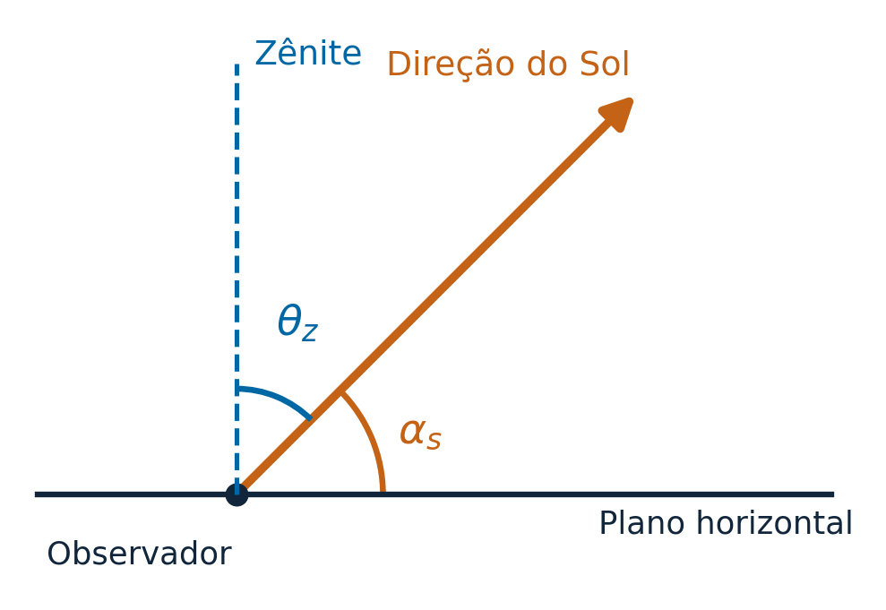
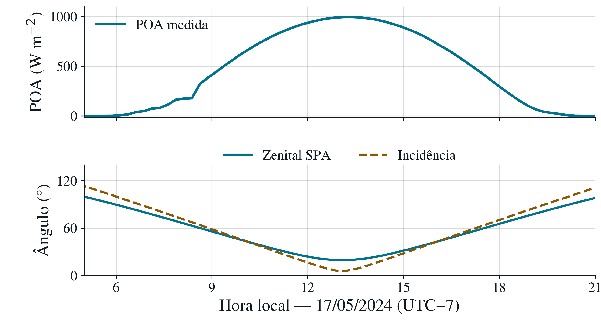

# 1 FUNDAMENTOS E CARACTERIZAÇÃO DO RECURSO SOLAR

Samuel Constantino Teixeira

## **1.1 GEOMETRIA SOLAR E IRRADIÂNCIA EXTRATERRESTRE**

SPGER0046 --- Energias Renováveis \| PPGER/UFPB\
Capítulo: Recurso solar e modelagem da conversão fotovoltaica\
Samuel Constantino Teixeira\
Convenções: norte 0°, sentido horário; geometria no ponto médio de cada intervalo.

### **1.1.1 PROBLEMA FÍSICO E FUNÇÃO DA GEOMETRIA SOLAR**

A caracterização do recurso solar exige distinguir a disponibilidade radiativa extraterrestre da irradiância efetivamente recebida por uma superfície terrestre. O movimento aparente do Sol define a direção instantânea de propagação da componente direta da radiação, enquanto a atmosfera e o entorno modificam o campo radiativo observado na superfície. Por essa razão, posição solar, irradiância extraterrestre e irradiância de superfície não são grandezas intercambiáveis. A geometria constitui uma condição de contorno física para a modelagem e a interpretação das observações, mas não determina, isoladamente, a irradiância medida. Essa distinção orienta a passagem da presente subseção para as componentes radiométricas (1.2) e para a modulação atmosférica (1.3) (DUFFIE; BECKMAN; BLAIR, 2020, p. 9--15).

A localização geográfica e o instante de observação são fundamentais. Para um ponto de latitude $\phi$, longitude $\lambda$ e tempo associado a uma escala definida, a direção solar aparente pode ser expressa por ângulos locais. Uma representação física coerente deve informar a convenção de azimute, o sistema de tempo e a posição do carimbo em relação ao intervalo da medição. Os algoritmos astronômicos, a exemplo do Solar Position Algorithm (SPA), formalizam essas transformações e permitem representar a posição do Sol por meio do ângulo zenital e do azimute (REDA; ANDREAS, 2004; 2008).

### **1.1.2 ÂNGULOS DE POSIÇÃO SOLAR**

Sejam $\phi$ a latitude geográfica \[graus\], $\delta$ a declinação solar \[graus\], $\omega$ o ângulo horário solar \[graus\] e $\theta_{z}$ o ângulo zenital geométrico, sem correção de refração atmosférica \[graus\]. A relação geométrica esférica elementar é (E1.01):

$$\cos\theta_{z} = \sin\phi\sin\delta + \cos\phi\cos\delta\cos\omega.$$

O ângulo $\theta_{z}$ é medido entre a direção do Sol e a vertical local. A elevação solar $\alpha_{s}$ corresponde ao ângulo entre a direção solar e o plano horizontal, de modo que $\alpha_{s} = 90^{\circ} - \theta_{z}$. Nessa formulação, $\omega = 0^{\circ}$ no meio-dia solar e, na aproximação usual de tempo solar verdadeiro, sua taxa é aproximadamente $15^{\circ}$ por hora, com valores negativos antes e positivos após o meio-dia solar. A declinação solar varia sazonalmente em função da posição orbital da Terra e da obliquidade do eixo terrestre (DUFFIE; BECKMAN; BLAIR, 2020, p. 13--15).

O **azimute solar** descreve a direção da projeção horizontal do vetor solar. Neste estudo, adota-se a convenção do norte geográfico como $0^{\circ}$, sentido horário: leste $90^{\circ}$, sul $180^{\circ}$ e oeste $270^{\circ}$, compatível com a configuração do caso PVDAQ e com Reda e Andreas (2004). Quando o Sol está exatamente no zênite, a direção azimutal é matematicamente indefinida, porque sua projeção horizontal se anula. Portanto, a condição $\theta_{z} = 0^{\circ}$ **não** implica azimute igual a zero.

{width="5.511809930008749in" height="3.7952909011373577in"}

Corte vertical ilustrativo da geometria solar local, com os ângulos zenital e de elevação. Fonte: elaboração própria a partir de Duffie, Beckman e Blair (2020). Representação esquemática, fora de escala.

A equação (E1.01) fornece a relação geométrica fundamental; cálculos de alta precisão precisam de tratamentos adicionais, como efemérides, escala temporal, refração atmosférica e correções de coordenadas. Reda e Andreas (2004, p. 577--578) descrevem o SPA para estimar a posição solar com elevada precisão angular. A incerteza divulgada para o próprio algoritmo não deve ser confundida com a incerteza da irradiância ou a qualidade de um sensor terrestre.

### **1.1.3 IRRADIÂNCIA EXTRATERRESTRE E PROJEÇÃO HORIZONTAL**

A irradiância extraterrestre normal, aqui denotada $G_{0n}$ \[W $m^{- 2}$\], representa o fluxo radiante por unidade de área perpendicular aos raios solares antes da interação atmosférica. Seu valor varia durante o ano devido à mudança da distância Terra--Sol. Uma representação conceitual dessa dependência é:

$$G_{0n}(t) = G_{sc}\left( \frac{r_{0}}{r(t)} \right)^{2},$$

na qual $G_{sc}$ \[W $m^{- 2}$\] é uma irradiância solar de referência na distância média $r_{0}$ e $r(t)$ é a distância Terra--Sol no instante considerado. A relação explicita a lei geométrica do inverso do quadrado, sem substituir o tratamento orbital usado pela implementação computacional. Diferentes referências históricas adotam constantes solares de valores próximos, mas não idênticos; aqui se fixa Gsc = 1366,1 W/m² para reproduzir a implementação do projeto (DUFFIE; BECKMAN; BLAIR, 2020, p. 9; PVLIB CONTRIBUTORS, 2026).

Na aproximação de Spencer implementada, E₀ é função do dia do ano n, com B = 2π(n − 1)/365 em radianos. Mantém-se o denominador 365 também para 2024, ano bissexto, conforme o método do software. O fator empregado é (PVLIB CONTRIBUTORS, 2026):

$$\begin{array}{r}
E_{0} = 1.000110 + 0.034221\cos B + 0.001280\sin B \\
 + 0.000719\cos(2B) + 0.000077\sin(2B).
\end{array}$$

A projeção da irradiância normal sobre um plano horizontal produz a irradiância extraterrestre horizontal $G_{0h}$ \[W $m^{- 2}$\] (E1.02):

$$G_{0h} = G_{0n}\max\left( 0,\cos\theta_{z} \right).$$

O operador $\max$ explicita a ausência de contribuição solar direta quando o Sol está abaixo do horizonte geométrico. Durante o dia, a equação se reduz a $G_{0h} = G_{0n}\cos\theta_{z}$. A dependência em cosseno é puramente geométrica: para o mesmo fluxo normal extraterrestre, a projeção na horizontal diminui à medida que o ângulo zenital aumenta. Isso **não** significa que $G_{0h}$ seja a GHI observada, pois esta última sofre os efeitos de absorção, espalhamento, nuvens, aerossóis e das demais condições atmosféricas.

Uma consequência importante é a impossibilidade de inferir a irradiância real de superfície apenas com posição solar e uma irradiância extraterrestre calculada. A decomposição entre a contribuição direta projetada e a radiação difusa no plano horizontal exige grandezas e hipóteses adicionais que pertencem à subseção 1.2.

### **1.1.4 MASSA DE AR E CAMINHO ÓPTICO**

A massa de ar relativa ($AM$) é um indicador do caminho óptico atravessado pela radiação direta em relação a uma direção vertical de referência. Em atmosfera plana e para ângulos zenitais moderados, uma aproximação geométrica é $AM \approx 1/\cos\theta_{z}$. Sua interpretação física é útil: próximo ao horizonte, o trajeto atmosférico é, em geral, mais extenso, o que amplia as oportunidades de absorção e espalhamento. Entretanto, a aproximação secante perde validade para grandes ângulos zenitais. Para aplicações quantitativas, deve-se empregar uma parametrização de massa de ar apropriada, distinguindo a massa de ar relativa da absoluta e informando eventuais correções de pressão (DUFFIE; BECKMAN; BLAIR, 2020, p. 9--10; SENGUPTA et al., 2024, cap. 2, p. 6--8).

A aproximação secante é utilizada como interpretação geométrica para zenitais moderados, aproximadamente até 70° no tratamento de Duffie, Beckman e Blair (2020, p. 9--10). Não deve ser extrapolada ao horizonte. A massa de ar relativa e sua correção de pressão para massa de ar absoluta precisam ser distinguidas em aplicações quantitativas.

### **1.1.5 ARTICULAÇÃO COM O CASO REAL PVDAQ 2107**

O estudo coletivo adota o sistema **Farm Solar Array --- PVDAQ 2107**, localizado em Arbuckle, Califórnia, nas coordenadas aproximadamente $38,996306^{\circ}$ N e $122,134111^{\circ}$ O. A janela analisada é de **1º de abril a 30 de junho de 2024**, com 91 dias, no fuso local America/Los_Angeles. A configuração do projeto registra a posição do Sol pelo SPA, aplicada ao meio do intervalo temporal correspondente, e utiliza a irradiância medida no plano do arranjo (plane of array, POA). As curvas de geometria e irradiância abaixo ilustram o dia 17 de maio de 2024 no horário local, conforme a coleção gráfica identificada como G01.

{width="5.984251968503937in" height="3.348331146106737in"}

Figura G01 --- POA observada e ângulos calculados no PVDAQ 2107, em 17/05/2024. POA: média de 15 minutos; posição solar no ponto médio. Fonte: dados preparados e configuração do projeto; cálculo de Samuel Constantino Teixeira, 2026. Zenital geométrico; incidência com zenital aparente, conforme a cadeia vigente.

O gráfico reúne naturezas distintas de informação. A POA provém da medição local agregada, enquanto zenital e incidência são calculados. Para 17/05, há 96 posições temporais, 94 médias POA não ausentes e 68 intervalos com três amostras na agregação. A figura exibe 05 h a 21 h locais, sem interpolação. A proximidade temporal entre o máximo de POA e a maior altura solar não constitui validação independente do SPA, nem permite identificar isoladamente condições de nuvens, aerossóis ou vapor de água. Trata-se de um exemplo diário, e não de uma distribuição climatológica.

O sistema PVDAQ disponibiliza irradiância POA, mas **não disponibiliza, neste conjunto selecionado, séries locais medidas e independentes de GHI, DNI e DHI**. Essas componentes não devem ser apresentadas como medições observadas; eventuais reconstruções por transposição inversa constituem análises exploratórias, discutidas separadamente. A orientação fixa do arranjo é de $25^{\circ}$ de inclinação e azimute $180^{\circ}$ (norte $0^{\circ}$, sentido horário), mas o detalhamento da montagem e a transposição para a POA pertencem às seções 2.4 e 3.1, respectivamente.

### **1.1.6 SÍNTESE E LIMITES**

A posição solar define a direção de incidência da componente direta e fornece o fator geométrico de projeção entre irradiância normal e horizontal. A irradiância extraterrestre estabelece uma referência física anterior à atenuação atmosférica. A passagem da geometria para o recurso disponível em superfície exige, entretanto, informação radiométrica adicional e descrição explícita de suas condições de observação. Assim, a subseção 1.1 estabelece os ângulos, o tempo e o referencial geométrico que serão empregados em 1.2 a 1.4 e compartilhados com o estudo fotovoltaico da equipe.

### **1.1.7 RASTREABILIDADE DO PROCEDIMENTO COMPUTACIONAL**

Os ângulos são calculados pelo SPA de Reda e Andreas (2004; 2008), enquanto a irradiância extraterrestre normal é calculada separadamente pelo método Spencer. A rotina utiliza pvlib 0.16.1. O exemplo publicado do SPA foi reproduzido com os parâmetros da Tabela A5.1 (REDA; ANDREAS, 2008, p. A-15--A-16), obtendo zenital aparente de 50,111622° e azimute de 194,340241°, compatíveis com os valores de referência arredondados. Essa conferência verifica a implementação numérica; não valida o sensor POA nem a precisão de todas as entradas do estudo de caso.

O caso PVDAQ 2107 utiliza 38,996306° N, 122,134111° O e altitude de 10 m na configuração do projeto. A janela compreende 01/04 a 30/06/2024, no fuso America/Los_Angeles. O rótulo temporal indica o início de intervalos de 15 minutos; o SPA é avaliado 7 min 30 s depois. Em 17/05/2024, o fuso corresponde a UTC−7. A pressão é estimada da altitude, enquanto temperatura de refração de 12 °C e diferença de escalas temporais ΔT = 67 s são padrões mantidos da implementação, sem tratá-los como medições locais ou como atualização específica de efemérides.

A conferência bibliográfica foi localizada por páginas, com distinção entre obras catalogadas e evidências efetivamente verificadas. O livro de Duffie, Beckman e Blair (2020, p. 9) apresenta 0,00719 no termo em cos(2B) de sua equação 1.4.1b. O código conferido do pvlib 0.16.1 utiliza 0,000719. Para reproduzir os cálculos do projeto, adota-se este último coeficiente, mantendo registrada a divergência entre as fontes; a comparação não constitui uma investigação de erratas do editor.

### **QUADRO DE CONCEITOS E CONVENÇÕES**

  --------------------------------------------------------------------------------------------------
  Símbolo                 Grandeza                                Unidade / convenção
  ----------------------- --------------------------------------- ----------------------------------
  $\phi$                  Latitude geográfica                     graus; norte positivo

  $\delta$                Declinação solar                        graus

  $\omega$                Ângulo horário solar                    graus; 0° ao meio-dia solar

  $\theta_{z}$            Ângulo zenital solar                    graus; 0° no zênite

  $\alpha_{s}$            Elevação solar                          graus; $90^{\circ} - \theta_{z}$

  $G_{0n}$                Irradiância extraterrestre normal       W/m²

  $G_{0h}$                Irradiância extraterrestre horizontal   W/m²

  POA                     Irradiância no plano dos módulos        W/m²; observada no PVDAQ
  --------------------------------------------------------------------------------------------------

**Critérios de validade e transição para 1.2**

A irradiância extraterrestre horizontal G₀h \[W m⁻²\] é calculada pela projeção da irradiância normal G₀n \[W m⁻²\] no plano horizontal, para o Sol acima do horizonte. GHI \[W m⁻²\] é outra grandeza: a irradiância global horizontal na superfície, modificada por absorção, espalhamento e nuvens. POA \[W m⁻²\] representa um plano inclinado e, no PVDAQ 2107, é a medição que alimenta a cadeia principal. Essas distinções fundamentam a subseção 1.2 e evitam substituir observações por cálculos.

## 1.2 Grandezas radiométricas e componentes da radiação

### 1.2.1 Irradiância e irradiação

A descrição do recurso solar exige identificar a grandeza física, o plano de referência e o intervalo temporal a que cada valor se refere. A irradiância corresponde à potência radiante incidente por unidade de área, expressa em watt por metro quadrado (W/m²). A irradiação representa a energia radiante recebida por unidade de área durante um intervalo definido, expressa no Sistema Internacional em joule por metro quadrado (J/m²). O uso de Wh/m² ou kWh/m² é conveniente em aplicações energéticas, desde que o intervalo de integração seja explicitado. Assim, irradiância e irradiação descrevem aspectos relacionados do recurso, mas não podem ser substituídas uma pela outra em equações ou eixos gráficos (DUFFIE; BECKMAN; BLAIR, 2020, p. 10).

Se $G(t)$ representa a irradiância no plano considerado, a irradiação entre os instantes $t_1$ e $t_2$ é

$$H_{[t_1,t_2]}=\int_{t_1}^{t_2}G(t)\,\mathrm{d}t.\tag{E1.03}$$

Com $G$ em W/m² e o tempo em segundos, $H$ é obtida em J/m². Quando o tempo é expresso em horas, a integração fornece Wh/m². A equivalência $1\,\mathrm{Wh/m^2}=3600\,\mathrm{J/m^2}$ decorre da definição de watt e da conversão entre hora e segundo. Para registros que representam médias de intervalos, a forma discreta é

$$H=\sum_{i\in\mathcal{V}}\overline{G}_i\,\Delta t_i,\tag{E1.04}$$

em que $\overline{G}_i$ é a irradiância média do intervalo, $\Delta t_i$ é sua duração e $\mathcal{V}$ é o conjunto de intervalos válidos. Essa soma representa a energia dos intervalos efetivamente incluídos; não reconstitui a energia dos intervalos ausentes. Se o registro for uma amostra instantânea, a integração por soma ou por outra quadratura constitui uma aproximação adicional. Portanto, a resolução nominal de um arquivo não informa, por si só, se seus valores são instantâneos, médios ou acumulados. A interpretação deve ser obtida nos metadados de aquisição e processamento (DUFFIE; BECKMAN; BLAIR, 2020, p. 10; SENGUPTA et al., 2024, cap. 6, p. 24–25).

### 1.2.2 Componentes direta, difusa e global horizontal

A interação da radiação solar com a atmosfera produz um campo radiativo com contribuições direcionais distintas. A irradiância direta normal, DNI, é referida a uma superfície perpendicular à direção solar e à radiação proveniente de uma pequena região angular centrada no Sol. A irradiância difusa horizontal, DHI, é a contribuição do céu recebida por uma superfície horizontal, excluída a região angular atribuída à componente direta. A irradiância global horizontal, GHI, representa a irradiância descendente total recebida no plano horizontal. As três grandezas são expressas em W/m²; suas diferenças decorrem da direção de recepção e do campo angular integrado, e não da unidade (SENGUPTA et al., 2024, cap. 2, p. 9–10).

Para o Sol acima do horizonte e para definições radiométricas compatíveis, o balanço geométrico ideal é

$$\mathrm{GHI}=\mathrm{DNI}\cos\theta_z+\mathrm{DHI}.\tag{E1.05}$$

O produto $\mathrm{DNI}\cos\theta_z$ é a componente direta projetada na horizontal. A equação deve utilizar um ângulo solar coerente com a aplicação, distinguindo a geometria da refração quando necessário. No fechamento de medidas reais, também importam o campo de visão do pireliômetro, o sombreamento aplicado ao sensor de DHI, a resposta angular dos sensores e sua sincronização. Por isso, um resíduo entre os termos medidos não pode ser atribuído automaticamente a uma falha atmosférica ou a um único instrumento (SENGUPTA et al., 2024, cap. 2, p. 10; cap. 3, p. 5–7).

A equação de fechamento é uma restrição física útil, mas não transforma uma medição isolada de GHI em três observações independentes. A estimação de DNI e DHI a partir de GHI requer modelos de decomposição, cuja validade depende de condições e escalas temporais. Próximo ao horizonte, estimar DNI pela divisão da componente direta horizontal por $\cos\theta_z$ amplifica a sensibilidade a pequenos erros, pois o denominador tende a zero. A caracterização das componentes deve, portanto, manter explícita a distinção entre valores medidos e estimados (SENGUPTA et al., 2024, cap. 2, p. 10–11).

### 1.2.3 Referência extraterrestre e irradiância no plano do arranjo

A irradiância extraterrestre normal $G_{0n}$ e sua projeção horizontal $G_{0h}$, definidas em 1.1, constituem referências anteriores à interação com a atmosfera. A presença do mesmo plano horizontal em $G_{0h}$ e GHI não as torna equivalentes: a primeira representa a projeção extraterrestre, enquanto a segunda descreve o campo radiativo disponível na superfície. Também não se deve impor que toda observação de curta duração seja necessariamente inferior a essa projeção, pois a redistribuição por nuvens pode produzir episódios de intensificação local da irradiância global (DUFFIE; BECKMAN; BLAIR, 2020, p. 9–10; SENGUPTA et al., 2024, cap. 6, p. 2).

A irradiância no plano do arranjo, POA, é referida à superfície dos módulos, que pode ser inclinada ou rastreada. Sua descrição separa a contribuição direta projetada nesse plano, a difusa proveniente do céu e a refletida pelo entorno. Essa separação conceitual identifica a natureza das parcelas sem impor um modelo de distribuição angular da radiação difusa. O cálculo de transposição e suas hipóteses pertencem à subseção 3.1; o albedo e a instalação são desenvolvidos nas subseções 2.2 e 2.4. A Seção 1 estabelece as grandezas necessárias a essas etapas, sem antecipar seus resultados (SENGUPTA et al., 2024, cap. 2, p. 1 e 9–11).

| Grandeza | Definição e plano | Unidade |
|:--|:--|:--|
| $G_{0n}$ | Irradiância extraterrestre normal ao feixe | W/m² |
| $G_{0h}$ | Projeção extraterrestre na horizontal | W/m² |
| DNI | Componente direta referida à normal solar | W/m² |
| DHI | Componente difusa recebida na horizontal | W/m² |
| GHI | Irradiância global recebida na horizontal | W/m² |
| POA | Irradiância recebida no plano do arranjo | W/m² |
| $H$ | Irradiação no plano e intervalo declarados | J/m², Wh/m² ou kWh/m² |

Fonte: elaboração de Samuel Constantino Teixeira a partir de Duffie, Beckman e Blair (2020, p. 9–15) e Sengupta et al. (2024, cap. 2, p. 9–11).

### 1.2.4 Aplicação ao PVDAQ 2107 e continuidade

No conjunto utilizado pelo capítulo, a POA observada constitui a entrada radiométrica local da cadeia principal. O arquivo preparado preserva o início de cada intervalo em UTC e um indicador da presença das três amostras previstas na agregação de 15 minutos. A posição solar é calculada no ponto médio, enquanto a POA conserva a natureza de média do intervalo. A Figura G01, discutida em 1.1, apresenta essas informações com suas diferentes origens explicitadas. Esse procedimento permite relacionar geometria e observação sem transformar o sensor POA em um sensor horizontal.

As componentes GHI, DNI e DHI eventualmente reconstruídas a partir da POA permanecem estimativas dependentes de modelos e hipóteses. A reprodução da POA de entrada por uma transposição inversa seguida da transposição direta não constitui validação independente dessas componentes. Essa conclusão resulta da dependência entre entradas e saídas do procedimento, e não de uma comparação realizada com sensores locais adicionais. A verificação das componentes exigiria referências observacionais ou estimativas externas com incerteza e independência documentadas.

A distinção entre potência radiativa, energia integrada e planos de recepção prepara a análise da modulação atmosférica em 1.3. Ela também define o requisito de comparabilidade para 1.4: duas séries somente podem ser confrontadas após compatibilizar a grandeza, o plano, o tempo de integração e o domínio de observação.

## 1.3 Modulação atmosférica e variabilidade espaço-temporal

### 1.3.1 Interação entre a radiação e a atmosfera

A geometria solar determina a direção do feixe e o referencial extraterrestre, enquanto a atmosfera modifica a intensidade, a distribuição angular e o conteúdo espectral da radiação disponível na superfície. A absorção converte energia radiante em energia interna do meio; o espalhamento altera a direção de propagação e redistribui parte da radiação entre o campo difuso, a superfície e o espaço. Consequentemente, a redução da componente direta não corresponde necessariamente à mesma redução da componente difusa ou da global (SENGUPTA et al., 2024, cap. 2, p. 6–7).

O percurso atmosférico depende da posição solar. Para ângulos zenitais moderados, a aproximação de atmosfera plana relaciona a massa de ar relativa à secante do zenital. À medida que o Sol se aproxima do horizonte, a curvatura da atmosfera e os efeitos de refração exigem tratamento mais adequado. Massa de ar, transmitância e irradiância não são sinônimos: a primeira caracteriza um percurso relativo; a segunda depende dos processos de extinção; a terceira é o fluxo por unidade de área resultante. Essa distinção evita atribuir à geometria uma capacidade explicativa que depende também das propriedades atmosféricas (DUFFIE; BECKMAN; BLAIR, 2020, p. 9–10; SENGUPTA et al., 2024, cap. 2, p. 6–8).

### 1.3.2 Nuvens e redistribuição da irradiância

As nuvens modificam o recurso por absorção e espalhamento, com resposta dependente de suas propriedades e da geometria entre Sol, nuvem e observador. A passagem de nuvens produz variações rápidas na componente direta e na irradiância global. A componente difusa pode manter uma contribuição relevante mesmo quando a direção do disco solar está obstruída. Em situações de céu parcialmente nublado, a redistribuição da radiação também pode intensificar temporariamente a irradiância recebida por um sensor. Portanto, uma curva com picos elevados não demonstra, isoladamente, ausência de nuvens, e um limite extraterrestre horizontal simples não deve funcionar como teto universal para toda observação sub-horária (SENGUPTA et al., 2024, cap. 2, p. 7; cap. 6, p. 2).

A resolução temporal condiciona a representação desses eventos. Uma média de 15 minutos suaviza variações que poderiam ser visíveis em amostras mais frequentes. Uma série horária, por sua vez, não preserva necessariamente as rampas sub-horárias presentes no sinal original. A escolha da resolução deve acompanhar o fenômeno que se pretende caracterizar: a integração energética de um período e a descrição de variações rápidas são problemas diferentes. Comparações entre séries precisam considerar como cada produto amostra ou agrega a radiação, além de sua frequência nominal (SENGUPTA et al., 2024, cap. 6, p. 2 e 24–25).

### 1.3.3 Aerossóis e vapor de água

Mesmo na ausência de nuvens, a atmosfera apresenta constituintes que absorvem e espalham radiação. A caracterização de aerossóis utiliza propriedades como profundidade óptica, albedo de espalhamento simples e distribuição angular do espalhamento. Essas propriedades dependem do comprimento de onda e não são substituídas por um único indicador visual de transparência do céu. A profundidade óptica de aerossóis, AOD, é uma entrada relevante para modelos de irradiância, especialmente para a componente direta normal sob céu sem nuvens (SENGUPTA et al., 2024, cap. 5, p. 10; cap. 6, p. 17).

O vapor de água participa da absorção espectral e é frequentemente descrito pela quantidade integrada na coluna atmosférica, denominada água precipitável ou vapor de água integrado. Essa grandeza não equivale à umidade relativa medida próximo à superfície, pois se refere à distribuição vertical do vapor ao longo da coluna. Uma modelagem que adote informações climatológicas de aerossóis e água precipitável produz resultados condicionados a essas entradas, mesmo quando calcula a posição solar com elevada precisão (SENGUPTA et al., 2024, cap. 5, p. 10–11; cap. 7, p. 3).

Não se deve converter essa fundamentação geral em atribuição causal específica sem informações adicionais. Uma diferença entre POA observada e uma curva de referência pode envolver mudanças atmosféricas, efeitos do entorno, geometria de recepção ou limitações da instrumentação. Identificar o mecanismo dominante exige observações ou variáveis que permitam discriminar essas possibilidades. No recorte do capítulo, essa ressalva impede inferir uma carga de aerossóis, uma quantidade de vapor ou uma condição de nebulosidade exclusivamente a partir de uma curva POA.

### 1.3.4 Escalas temporais e espaciais

A variabilidade do recurso inclui a alternância diária imposta pela rotação terrestre, a sazonalidade associada à geometria orbital e mudanças meteorológicas em diversas escalas. A interpretação deve explicitar qual componente é analisada, em qual intervalo e em qual domínio espacial. A variabilidade de DNI em segundos não representa o mesmo objeto que a variabilidade de médias mensais de GHI. Além disso, a agregação de observações distribuídas espacialmente pode reduzir parte das flutuações rápidas que aparecem em um ponto individual (SENGUPTA et al., 2024, cap. 6, p. 1–2).

Em escala espacial, nuvens, relevo e padrões locais de circulação podem produzir diferenças entre localidades próximas. Essas diferenças limitam a extrapolação de uma estação para o entorno e a interpretação pontual de produtos em grade. A representatividade depende do regime de variabilidade, da resolução dos dados e da aplicação. Uma grade mais detalhada pode representar melhor algumas heterogeneidades, mas a redução do tamanho do pixel não assegura, por si só, menor erro na estimativa radiativa (SENGUPTA et al., 2024, cap. 6, p. 17).

Uma campanha curta também não estabelece automaticamente a distribuição climatológica do recurso. O histórico observado precisa ser interpretado à luz da sazonalidade, da variabilidade interanual e da duração do registro. Dados sintetizados como ano meteorológico típico apresentam outra finalidade: representam condições estatísticas selecionadas de um histórico e não reconstituem o tempo efetivamente ocorrido em um trimestre particular. Confundir essas escalas compromete tanto a interpretação física quanto a comparação entre medições e estimativas (SENGUPTA et al., 2024, cap. 6, p. 24; cap. 8, p. 4).

### 1.3.5 Alcance do exemplo PVDAQ 2107

A janela de abril a junho de 2024 do PVDAQ 2107 permite estudar a evolução observada da POA naquele sistema e período. A Figura G01 mostra um dia dessa janela em conjunto com ângulos calculados. O movimento diário dos ângulos decorre do cálculo astronômico, enquanto a curva POA reúne o resultado radiativo efetivamente registrado no plano do sensor. A proximidade entre horários de grande irradiância e de elevada altura solar é fisicamente compreensível, mas não isola os efeitos de nuvens, aerossóis ou vapor de água.

Assim, o exemplo é empregado como evidência da distinção entre geometria calculada e radiação observada. Ele não sustenta uma classificação climática de Arbuckle, uma atribuição de causa atmosférica para cada flutuação ou uma extrapolação do recurso para o ano completo. As limitações de amostragem, origem e representatividade conduzem à subseção 1.4, que examina como medições e diferentes formas de estimação podem caracterizar o recurso com incertezas explícitas.

## 1.4 Medição e estimativa do recurso solar

### 1.4.1 Medições radiométricas de superfície

A caracterização do recurso solar combina observações de superfície e estimativas que ampliam a cobertura temporal ou espacial. A medição local fornece uma referência próxima às condições de operação do sistema, mas sua utilidade depende da grandeza medida, da instalação, da manutenção e da rastreabilidade da calibração. Um instrumento não representa indistintamente todas as componentes da radiação, e a existência de um arquivo numérico não substitui a avaliação de sua qualidade (SENGUPTA et al., 2024, cap. 3, p. 3–7; cap. 4, p. 1).

Piranômetros instalados horizontalmente são empregados na medição de GHI; com o bloqueio adequado da contribuição direta, permitem medir DHI. Pireliômetros acompanham a direção solar e medem DNI em um campo de visão restrito. Sensores posicionados no plano dos módulos medem a irradiância correspondente à orientação dessa superfície. Portanto, o plano de montagem é parte da definição do mensurando, e não um detalhe dispensável dos metadados (SENGUPTA et al., 2024, cap. 3, p. 5–7).

A tecnologia do detector também importa. Sensores de termopilha e sensores fotoelétricos apresentam respostas espectrais e temporais diferentes. Uma comparação deve considerar essas características, além de nivelamento, obstruções, limpeza, sincronização e estabilidade da aquisição. A classe ou a especificação nominal do instrumento não encerra a incerteza da medição em campo, porque instalação, ambiente e processamento acrescentam contribuições próprias (SENGUPTA et al., 2024, cap. 3, p. 5–7; cap. 10, p. 5–6).

### 1.4.2 Estimativas por satélite, reanálises e atlas

Produtos derivados de satélite estimam a radiação na superfície a partir de informações observadas pelo sensor orbital e de modelos que representam as interações atmosféricas. Métodos físicos podem recuperar propriedades de nuvens e utilizá-las em modelos de transferência radiativa; métodos empíricos ou semiempíricos relacionam observações orbitais e condições radiométricas de superfície por procedimentos de calibração e parametrização. Dessa forma, o valor de irradiância de superfície de um produto de satélite é uma estimativa modelada, ainda que utilize medições remotas como entrada (SENGUPTA et al., 2024, cap. 7, p. 1–3 e 7–8).

Reanálises fornecem séries históricas produzidas por sistemas de modelagem atmosférica com assimilação de observações. A irradiância de superfície é uma variável diagnosticada pelo sistema e permanece dependente da representação de nuvens e demais processos radiativos. ERA5 e MERRA-2 são exemplos discutidos na literatura técnica; sua identificação como reanálises não deve ser confundida com a existência de uma estação radiométrica em cada ponto da grade. Comparações locais devem examinar a documentação específica do produto e sua aderência ao regime de interesse (SENGUPTA et al., 2024, cap. 7, p. 2).

Atlas solarimétricos sintetizam a distribuição espacial de indicadores do recurso, frequentemente como médias ou totais de períodos extensos. A interpretação de um mapa depende da base subjacente, do período, da componente e da unidade. Um atlas não constitui necessariamente uma medição independente dos produtos que utiliza e, por apresentar uma síntese climatológica, não reconstitui automaticamente uma sequência diária observada. Essa interpretação é uma consequência da agregação espacial e temporal: a comparação deve preservar o suporte estatístico da grandeza representada (SENGUPTA et al., 2024, cap. 6, p. 17 e 24; cap. 8, p. 4).

### 1.4.3 Resolução e representatividade

A resolução espacial informa o suporte ou detalhamento nominal do produto, enquanto a resolução temporal descreve sua frequência ou agregação. Representatividade é a capacidade de esses dados descreverem o domínio e o fenômeno de interesse. Uma estação caracteriza a recepção radiativa no local e no plano de seu sensor; um produto em grade representa uma estimativa associada a uma área e a um procedimento espacial. Os dois suportes podem responder de modo diferente a heterogeneidades de nebulosidade e relevo, mesmo com carimbos temporais coincidentes (SENGUPTA et al., 2024, cap. 6, p. 17).

No tempo, coincidência de rótulos não assegura equivalência de integração. Um valor instantâneo às 12 h, uma média entre 12 h e 12 h 15 min e uma energia acumulada desde o início da hora representam objetos diferentes. Antes do confronto, é necessário verificar o fuso, a posição do rótulo no intervalo, a duração da integração e o tratamento do horário de verão. A harmonização deve preservar a energia quando converte entre irradiância média e irradiação. Aumentar artificialmente a frequência de uma série por interpolação não recupera as flutuações que não foram observadas (DUFFIE; BECKMAN; BLAIR, 2020, p. 10–11; SENGUPTA et al., 2024, cap. 6, p. 24–25).

### 1.4.4 Qualidade, completude e incerteza

O controle de qualidade deve identificar registros ausentes, valores suspeitos e condições que comprometem a interpretação física. Testes automáticos precisam ser complementados pela inspeção das séries e pelo conhecimento da instrumentação. Um único sensor POA limita a aplicação de testes que dependeriam de observações independentes de outras componentes. A remoção de dados também altera a amostra disponível e precisa ser acompanhada de justificativa e identificação dos intervalos envolvidos (SENGUPTA et al., 2024, cap. 4, p. 1 e 15).

A completude pode ser expressa pela razão entre os registros válidos e os registros esperados no domínio analisado. Esse indicador deve informar se abrange o período inteiro, apenas os intervalos diurnos ou uma amostra comum entre produtos. Percentuais obtidos com denominadores distintos não são diretamente comparáveis. Um limite de aceitação é uma decisão do protocolo do estudo e não deve ser apresentado como regra universal sem fundamentação específica. Além disso, alta completude não demonstra ausência de viés, assim como uma série sem lacunas pode conter valores sistematicamente incorretos.

A incerteza da medição reúne contribuições do instrumento, da calibração, da aquisição e das condições de campo. Nas estimativas modeladas, acrescentam-se limitações das entradas, da representação física e de sua propagação até a saída. A comparação com uma referência observacional também incorpora a incerteza dessa referência e diferenças de representatividade. Assim, métricas de erro são evidências sobre a discrepância na amostra confrontada, mas não equivalem, isoladamente, a uma descrição completa da incerteza do recurso (SENGUPTA et al., 2024, cap. 10, p. 5–6). O tratamento quantitativo do desempenho da modelagem e de suas métricas permanece atribuído à Seção 4.

### 1.4.5 Aplicação e limites do PVDAQ 2107

O estudo coletivo utiliza a POA local como entrada radiativa principal e calcula os ângulos solares com a localização e o tempo documentados. No arquivo de 15 minutos empregado para a conferência da Seção 1, a grade temporal contém 8.736 intervalos entre 1º de abril e 1º de julho de 2024, com término exclusivo, correspondendo a 91 dias locais. Essa quantidade descreve a grade esperada, e não demonstra que todas as observações sejam válidas.

Em 17 de maio, há 96 posições temporais, 94 médias POA não ausentes e 68 intervalos com três amostras de irradiância na agregação. São indicadores diferentes: disponibilidade da média e completude das amostras de origem. Esses resultados foram obtidos pela leitura e conferência do CSV preparado, sem preencher lacunas ou transformar a série reconstruída em observação. A Figura G01 utiliza os pontos médios para a apresentação conjunta da geometria e das médias observadas, mantendo a diferença de suporte temporal registrada no método.

Não foram disponibilizadas, na seleção utilizada pelo capítulo, medições locais independentes de GHI, DNI e DHI. Consequentemente, estimativas obtidas a partir da POA devem conservar a identificação de reconstrução e não podem funcionar como referência independente para a própria cadeia que as gerou. A caracterização do recurso termina, portanto, com um conjunto de entradas, convenções e limitações verificáveis. Essas informações fundamentam as seções seguintes sobre ambiente de instalação, conversão fotovoltaica e avaliação de desempenho, preservando o alcance das evidências disponíveis.

# Referências

DUFFIE, John A.; BECKMAN, William A.; BLAIR, Nathan. **Solar engineering of thermal processes, photovoltaics and wind**. 5. ed. Hoboken: Wiley, 2020. ISBN 9781119540311. DOI: https://doi.org/10.1002/9781119540328.

NOAA GLOBAL MONITORING LABORATORY. **General solar position calculations**. [S. l.]: NOAA, [s. d.]. 2 p. Disponível em: https://gml.noaa.gov/grad/solcalc/solareqns.PDF. Acesso em: 27 out. 2026.

PVLIB CONTRIBUTORS. **pvlib python: get_extra_radiation e spa_python**. Versão 0.16.1. 2026. Disponível em: https://pvlib-python.readthedocs.io/en/v0.16.1/reference/generated/pvlib.irradiance.get_extra_radiation.html. Acesso em: 27 out. 2026.

REDA, Ibrahim; ANDREAS, Afshin. Solar position algorithm for solar radiation applications. **Solar Energy**, v. 76, n. 5, p. 577–589, 2004. DOI: https://doi.org/10.1016/j.solener.2003.12.003.

REDA, Ibrahim; ANDREAS, Afshin. **Solar position algorithm for solar radiation applications**. Revised January 2008. Golden: National Renewable Energy Laboratory, 2008. Relatório NREL/TP-560-34302. DOI: https://doi.org/10.2172/15003974.

SENGUPTA, Manajit et al. (ed.). **Best practices handbook for the collection and use of solar resource data for solar energy applications**. 4. ed. Golden: National Renewable Energy Laboratory, 2024. Relatório NREL/TP-5D00-88300. Disponível em: https://docs.nrel.gov/docs/fy24osti/88300.pdf. Acesso em: 27 out. 2026.

TEIXEIRA, Samuel Constantino et al. **SPGER0046 Energias Renováveis: configuração e dados preparados do estudo PVDAQ 2107**. 2026. Repositório de trabalho. Dados utilizados: abril a junho de 2024. Disponível em: https://github.com/samuelasroma-byte/SPGER0046_Energias_Renovaveis. Acesso em: 27 out. 2026.
